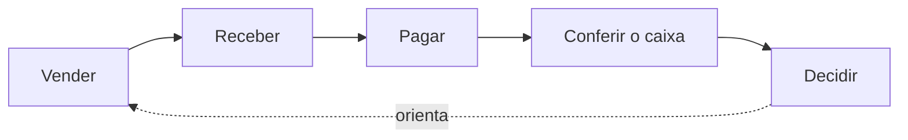

# Capacidades de negócio

**Público:** negócio (comerciante, patrocinador). **Nível:** resultado e impacto.
**Requisito atendido:** mapeamento de capacidades de negócio (O1).
**Data:** 2026-10-12.

## 1. O problema em três linhas

Um comerciante movimenta dinheiro o dia inteiro: entra dinheiro das vendas, sai dinheiro para fornecedores, aluguel e despesas. Ao fim do dia, ele precisa saber quanto entrou, quanto saiu e qual foi o resultado. Esta solução registra cada movimento de caixa e entrega o saldo consolidado de cada dia.

Não se trata de conta corrente bancária: não há limite, juros, cliente bancário nem saldo negativo bloqueado. É o livro-caixa do negócio.

## 2. Cadeia de valor do comerciante

| Etapa | O que acontece | Onde a solução entra |
|---|---|---|
| Vender | Mercadoria ou serviço é entregue ao cliente | Fora do escopo: a venda nasce em balcão, maquininha ou sistema de vendas |
| Receber | Dinheiro entra no caixa (espécie, cartão, Pix) | **Registro de crédito** |
| Pagar | Dinheiro sai do caixa (fornecedor, aluguel, despesa) | **Registro de débito** |
| Conferir o caixa | O comerciante confere o que entrou e saiu no dia e corrige erros | **Lista do dia, estorno, saldo diário consolidado** |
| Decidir | Comprar mais, adiar pagamento, ajustar preço | **Saldo diário consolidado** como insumo; a decisão é do comerciante |

O registro de cada movimento acontece durante todo o expediente e não pode esperar. A conferência acontece em momentos pontuais, quase sempre no fim do dia, e pode tolerar um atraso curto. Essa diferença de urgência é o fato de negócio que orienta todo o desenho.

## 3. Mapa de capacidades

Nível 1 é o que o negócio precisa ser capaz de fazer; nível 2 é como essa capacidade se decompõe.

**Escala de criticidade**, expressa em impacto no negócio:

- **Crítica:** se parar, o comerciante perde registro de dinheiro que entrou ou saiu. A perda é de informação financeira e pode ser irrecuperável.
- **Alta:** se parar, a conferência fica impossível ou incorreta até a capacidade voltar; nenhum dado é perdido.
- **Tolerável:** se parar por algum tempo, o comerciante espera; nenhum dado é perdido e a operação continua.
- **Fora do escopo:** reconhecida, não atendida nesta entrega.

| Nível 1 | Nível 2 | Valor gerado | Criticidade | Domínio |
|---|---|---|---|---|
| **C1. Registrar movimentos de caixa** | C1.1 Registrar entrada de dinheiro (crédito) | Nenhuma venda recebida fica sem registro | Crítica | Controle de Lançamentos |
| | C1.2 Registrar saída de dinheiro (débito) | Nenhum pagamento fica sem registro | Crítica | Controle de Lançamentos |
| | C1.3 Evitar registro em dobro quando o envio se repete | Uma falha de conexão não infla nem reduz o caixa | Crítica | Controle de Lançamentos |
| | C1.4 Corrigir lançamento errado por estorno | Erro corrigido sem apagar histórico; a conferência continua rastreável | Alta | Controle de Lançamentos |
| **C2. Conferir o caixa** | C2.1 Listar os lançamentos de um dia | O comerciante vê cada movimento que compõe o dia | Alta | Controle de Lançamentos |
| | C2.2 Consultar o saldo diário consolidado | Total de entradas, total de saídas e resultado do dia em uma consulta | Tolerável | Consolidado Diário |
| | C2.3 Saber até quando o saldo está atualizado | O comerciante sabe se o número já reflete o último lançamento | Tolerável | Consolidado Diário |
| **C3. Apoiar a decisão** | C3.1 Saldo acumulado entre dias | Visão de evolução do caixa | Fora do escopo (QA-01) | Consolidado Diário, evolução |
| | C3.2 Relatórios por período e categoria | Análise de despesas e receitas | Fora do escopo | |
| **C4. Integrar meios de recebimento** | C4.1 Importar vendas da maquininha | Menos digitação | Fora do escopo | Externo, especificado |
| | C4.2 Conciliar com o extrato bancário | Conferência automática contra o banco | Fora do escopo | Externo, especificado |

## 4. Ligação com os dois serviços do enunciado

O enunciado nomeia dois serviços. Eles correspondem a capacidades de criticidade diferente:

| Serviço do enunciado | Capacidades | Criticidade dominante | Consequência de negócio |
|---|---|---|---|
| **Controle de lançamentos** | C1.1, C1.2, C1.3, C1.4, C2.1 | Crítica | Precisa estar disponível durante todo o expediente |
| **Consolidado diário** | C2.2, C2.3 | Tolerável | Pode ficar fora do ar ou atrasado por algum tempo sem perda de dado; o enunciado aceita até 5% de perda de requisições em pico |

**Consequência para o desenho:** a parte tolerável não pode derrubar a parte crítica. O enunciado exige isso por escrito: o controle de lançamentos não deve ficar indisponível se o consolidado diário cair. A separação, a fronteira e o sentido da dependência estão em [02-dominios-funcionais.md](02-dominios-funcionais.md); a meta mensurável está em [03-requisitos.md](03-requisitos.md), RNF-01.

## 5. Indicadores de negócio a acompanhar

| Indicador | O que revela | Meta |
|---|---|---|
| Disponibilidade do registro de lançamentos | Se o comerciante consegue registrar o tempo todo | RNF-01 |
| Atraso do saldo consolidado em relação ao último lançamento | Se a conferência reflete o caixa real | RNF-05 |
| Taxa de erro da consulta de saldo em pico | Se a conferência atende o comerciante no momento de maior uso | RNF-02, RNF-03 |
