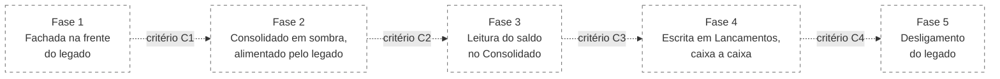
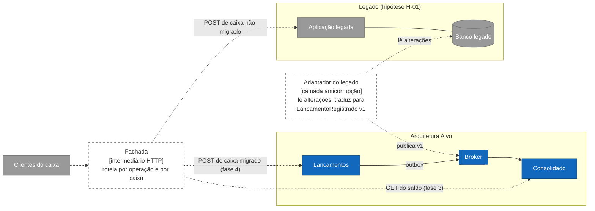

# Arquitetura de Transição

**Público:** misto: negócio (seções 1 e 2), TI (3 a 6).
**Data:** 2026-10-12. **Estado:** **especificado, não implementado.** Nada neste documento existe em código.

## 1. Resumo

O enunciado não descreve um sistema atual. Este documento parte de uma **hipótese** declarada de legado e mostra como substituí-lo pela [Arquitetura Alvo](04-arquitetura-alvo.md) sem parar o caixa do comerciante e sem um dia de "virada" única. A substituição acontece em cinco fases. Cada fase tem um critério objetivo para avançar e um caminho de volta. O comerciante continua registrando normalmente durante toda a transição; o que muda, fase a fase, é qual sistema atende cada operação por trás.

## 2. Hipótese de legado

| ID | Hipótese | Impacto se não se confirmar |
|---|---|---|
| H-01 | O comerciante usa hoje um sistema de caixa único: um processo e um banco de dados atendem tanto o registro de lançamentos quanto o relatório de saldo | Se o legado for planilha ou papel, as fases 1 a 3 se reduzem a uma carga inicial de histórico e a transição vira implantação direta |
| H-02 | O legado expõe o registro e a consulta por HTTP, ou pode ser colocado atrás de um intermediário HTTP sem alterar os clientes | Sem isso, a fachada da fase 1 vira mudança nos clientes (caixa, maquininha), e cada cliente migra em sua própria onda |
| H-03 | O banco do legado permite leitura de alterações (log de transações ou tabela com data de alteração) | Sem isso, a fase 2 usa exportação periódica e a reconciliação passa a ter atraso de horas, não de segundos |
| H-04 | Lançamentos no legado têm identificador estável | Sem isso, a carga de histórico precisa gerar identificador e chave de idempotência derivados do conteúdo, com risco de colisão a medir |
| H-05 | O sintoma que motiva a troca é o mesmo que a Arquitetura Alvo resolve: relatório pesado derruba ou trava o registro | Se a motivação for outra (custo, licença), a ordem das fases pode inverter, migrando a escrita primeiro |

Toda hipótese é questão aberta a confirmar com o negócio antes da fase 1, no mesmo formato das QA de [03-requisitos.md](03-requisitos.md).

## 3. Estratégia: estrangulamento por fachada

**Decisão proposta:** substituir o legado pelo padrão de estrangulamento (strangler fig): uma fachada passa a receber todo o tráfego, e cada operação é desviada do legado para o serviço novo quando o critério da fase é cumprido. A leitura migra antes da escrita, porque o Consolidado é sacrificável e reconstruível; um erro nele não perde dado. A escrita, que é crítica, migra por último, caixa a caixa.

**Alternativa rejeitada: virada única (big bang).** Um fim de semana de migração e troca total. Rejeitada porque o registro de caixa não tem janela sem uso garantida e porque o caminho de volta, depois de lançamentos novos, exige reconciliação manual. *Voltaria a ser a melhor escolha* se o volume de histórico fosse pequeno, houvesse janela de parada aceita pelo negócio e o legado fosse incapaz de conviver com a fachada (H-02 falsa).

**Alternativa rejeitada: escrita dupla pela aplicação** (cliente grava no legado e no novo). Rejeitada porque cria dois registros sem fonte da verdade definida e falhas parciais sem dono. *Voltaria* se não houver como ler alterações do legado (H-03 falsa) e a reconciliação diária fosse aceitável.

**Regra preservada em todas as fases:** Lancamentos nunca depende do Consolidado (regra 1 da Arquitetura Alvo). O acoplamento transitório fica no adaptador do legado, que é descartado na fase 5.

## 4. Fases

| Fase | O que muda | Quem é a fonte da verdade | Critério para avançar | Caminho de volta |
|---|---|---|---|---|
| **1. Fachada** | Um intermediário HTTP passa a receber todo o tráfego e repassa ao legado, sem alterar comportamento. Mede-se a linha de base: volume, latência e erros por operação | Legado | **C1:** 100% do tráfego passa pela fachada por um período contínuo sem incidente atribuído a ela; linha de base registrada. Duração do período a definir com o negócio `[NVI]` | Apontar os clientes de volta ao legado |
| **2. Consolidado em sombra** | Um adaptador lê as alterações do banco do legado (H-03), traduz para `LancamentoRegistrado` v1 e publica no broker. O Consolidado novo projeta, mas ninguém o consulta. Uma reconciliação diária compara o saldo do legado com o projetado | Legado | **C2:** divergência zero de saldo por caixa e por dia, em dias consecutivos, cobrindo pelo menos um pico de movimento. Quantidade de dias a definir `[NVI]` | Desligar o adaptador; nada visível mudou |
| **3. Leitura migrada** | A fachada desvia a consulta de saldo para o Consolidado. O legado continua recebendo os registros. O relatório pesado deixa de rodar no processo do legado, o que já alivia o sintoma de H-05 | Legado para escrita; Consolidado para leitura | **C3:** teste de carga de 50 req/s com perda ≤ 5% no ambiente real (RNF-02); defasagem dentro do RNF-05; reconciliação segue zerada; retorno da leitura ao legado ensaiado | Fachada volta a rotear a consulta para o legado |
| **4. Escrita migrada por caixa** | Para um caixa piloto, o histórico é carregado em Lancamentos (com chave de idempotência derivada do identificador do legado, H-04) e a fachada passa a rotear o `POST` desse caixa para Lancamentos. O adaptador do legado deixa de publicar eventos desse caixa. Em ondas, os demais caixas seguem | Lancamentos para os caixas migrados; legado para os demais | **C4:** todos os caixas migrados; em cada onda, reconciliação do histórico carregado contra o legado sem divergência, zero lançamento perdido ou duplicado, e nenhum registro novo no legado para caixa migrado | Por caixa: a fachada volta o `POST` ao legado, e os lançamentos feitos no novo durante a onda são reaplicados no legado por um adaptador reverso, mantido só até o fim da fase |
| **5. Desligamento** | O legado deixa de receber tráfego. Exportação final, arquivamento auditado e remoção do adaptador e da leitura do banco antigo | Lancamentos | Nenhuma requisição ao legado por um período definido; arquivo conferido por amostragem; adaptador e credenciais removidos | Restaurar o legado a partir do arquivo, só como contingência de auditoria |

## 5. Arquitetura durante a transição (fases 2 a 4)

Lancamentos, broker e Consolidado estão implementados neste repositório; fachada e adaptador do legado são especificados. O Consolidado não distingue a origem do evento: o contrato v1 é o mesmo para o adaptador e para a outbox. Por isso a fase 4 não altera o Consolidado.

## 6. Riscos e mitigações

| Risco | Fase | Mitigação |
|---|---|---|
| Adaptador lendo o banco legado gera carga no sistema que se quer proteger | 2 a 4 | Leitura do log de transações em vez de consultas; réplica de leitura do legado, se existir |
| Evento duplicado pelo adaptador e pela outbox para o mesmo lançamento durante a troca de onda | 4 | O adaptador para de publicar o caixa antes de a fachada desviar o `POST`; o projetor descarta duplicata pela chave do lançamento |
| Diferença de regra entre legado e novo (por exemplo, legado aceita data futura, QA-03) | 2 | A reconciliação da fase 2 expõe a diferença antes de qualquer usuário ver; a camada anticorrupção decide a tradução, registrada como questão aberta |
| Fachada vira ponto único de falha | 1 a 4 | Instância redundante e sem estado; é a única peça nova no caminho crítico durante a transição |
| Rollback da fase 4 com lançamentos já feitos no novo | 4 | Adaptador reverso por caixa, ensaiado no piloto antes da primeira onda |

**Custo da transição:** a fachada, o adaptador e o adaptador reverso são código que existe só para ser descartado. É o preço de não ter um dia de virada. A estimativa de esforço depende do legado real e deverá ser refinada após o levantamento das hipóteses H-01 a H-05.
