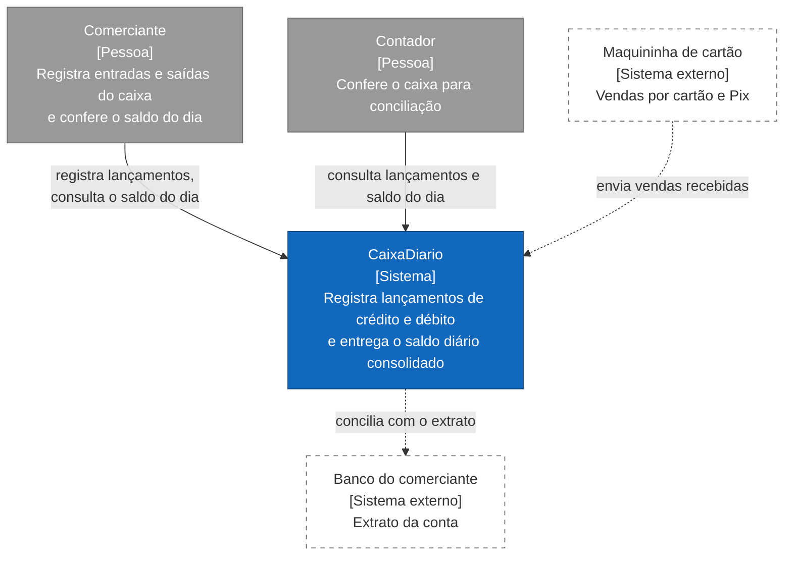

# C1: Contexto

Quem usa o CaixaDiario e com quem ele conversa. Público: negócio. Sem infraestrutura. Convenções em [README](README.md).

## Estado de cada elemento

| Elemento | Estado | Observação |
|---|---|---|
| Comerciante, contador | Pessoas | Sem autenticação no ambiente local (QA-04) |
| CaixaDiario | Ver [C2](c2-conteineres.md) | |
| Maquininha de cartão | Especificado, fora do escopo | Capacidade C4.1; o enunciado não exige integração externa |
| Banco do comerciante | Especificado, fora do escopo | Capacidade C4.2 |

## O que o diagrama diz ao negócio

O comerciante lança cada movimento de dinheiro e consulta o resultado do dia. As integrações com maquininha e banco reduziriam digitação e automatizariam a conferência, mas não são necessárias para o problema do enunciado; ficam como evolução.
