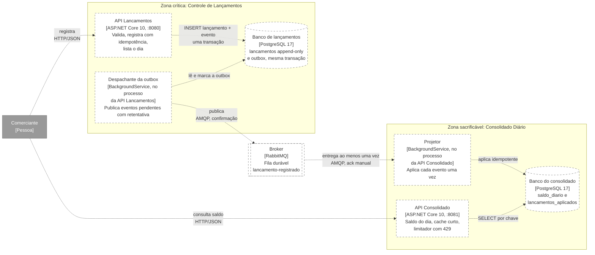

# C2: Contêineres

Processos e armazenamentos que compõem o CaixaDiario. Público: TI. Convenções em [README](README.md). Decisões em [ADR-0001](../adr/ADR-0001-estilo-arquitetural.md) e [ADR-0002](../adr/ADR-0002-plataforma-armazenamento-e-integracao.md).

## Por que Lancamentos sobrevive à queda do Consolidado

Siga as setas: **nenhuma sai da zona sacrificável em direção à zona crítica.** A API Lancamentos só fala com o próprio banco; o despachante só fala com o próprio banco e com o broker. Nada na zona crítica chama, lê ou espera o Consolidado ou o banco dele.

| Falha | Efeito na zona crítica | Efeito na zona sacrificável |
|---|---|---|
| API Consolidado fora | Nenhum | Consulta indisponível; a fila retém os eventos |
| Banco do consolidado fora | Nenhum | Consulta e projeção param; a fila retém |
| Consolidado sobrecarregado | Nenhum | Excedente recebe `429`, dentro do orçamento de 5% |
| Broker fora | Registro segue com `201`; a outbox acumula no banco de lançamentos | Saldo fica defasado e sinaliza `defasado: true` |
| Banco de lançamentos fora | Registro indisponível | Consulta segue servindo o último saldo projetado |

A prontidão (`/health/ready`) da API Lancamentos verifica **só** o banco de lançamentos. Nunca o broker, nunca o Consolidado.

## Estado de cada elemento

| Elemento | Estado | Evidência |
|---|---|---|
| API Lancamentos | Especificado | Implementação no Bloco 4 |
| Despachante da outbox | Especificado | Implementação no Bloco 4 |
| Banco de lançamentos | Especificado | Implementação no Bloco 4 |
| Broker | Especificado | Implementação no Bloco 4 |
| Projetor | Especificado | Implementação no Bloco 4 |
| API Consolidado | Especificado | Implementação no Bloco 4 |
| Banco do consolidado | Especificado | Implementação no Bloco 4 |

## Decisões que o diagrama torna visíveis

- **Dependência unidirecional:** Lancamentos → broker → Consolidado. É ela que entrega o RNF-01 (ADR-0001).
- **Um banco por serviço:** derrubar o Consolidado e o banco dele não toca o banco de lançamentos (ADR-0002).
- **Lançamento e evento na mesma transação:** a outbox impede lançamento sem evento e evento sem lançamento (ADR-0002, tema 4).
- **Despachante e projetor no processo da própria API:** menos executáveis a operar; o custo é que reiniciar a API reinicia o despacho ou a projeção, o que a outbox e a fila durável tornam inofensivo.
