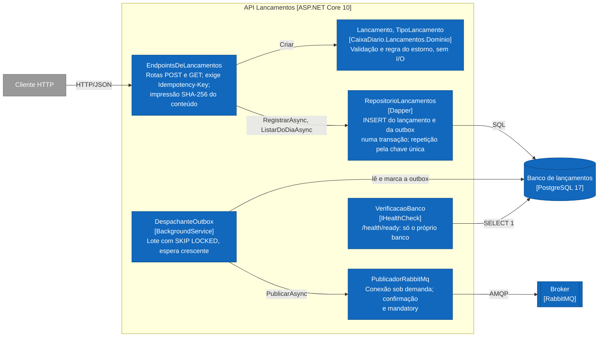
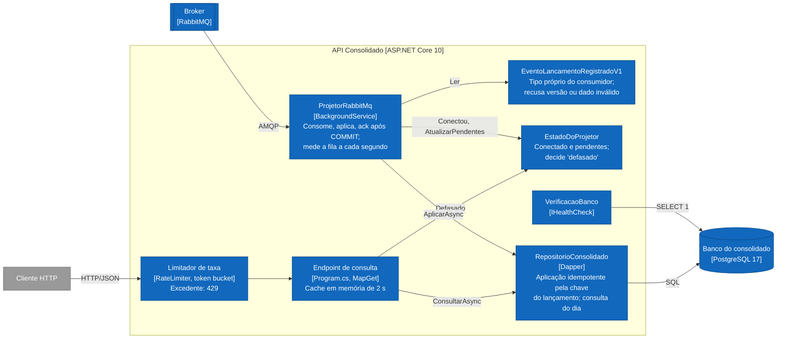

# C3: Componentes

Componentes dentro de cada API, desenhados a partir do código em `src/`, não do desejo. Público: engenharia. Convenções em [README](README.md). Cada caixa nomeia a classe que a implementa.

## API Lancamentos

## API Consolidado

## Onde cada regra vive

| Regra | Componente | Garantia final |
|---|---|---|
| Valor positivo, duas casas, data não futura, estorno coerente (RF-03, RF-05) | `Lancamento` | Domínio; o banco repete `valor > 0` e o estorno único por constraint |
| Idempotência (RNF-07) | `RepositorioLancamentos` | Chave única `(caixa_id, chave_idempotencia)` no banco |
| Lançamento e evento juntos (RNF-04) | `RepositorioLancamentos` | Transação local |
| Imutabilidade (RNF-06) | Nenhum componente: privilégio do papel no banco | `GRANT SELECT, INSERT` |
| Registro não depende de Consolidado nem de broker (RNF-01) | `VerificacaoBanco`, `PublicadorRabbitMq` sob demanda, `DespachanteOutbox` fora do caminho do POST | Teste de arquitetura e teste de integração sem Consolidado |
| Evento sem fila não é descartado | `PublicadorRabbitMq` (`mandatory`) | Evento fica na outbox |
| Aplicação única por lançamento (RF-10) | `RepositorioConsolidado` | Chave primária de `lancamentos_aplicados` |
| Degradação em pico (RNF-02, RNF-03) | Limitador e cache | Teste de carga e rajada |
| Sinalização de atraso (RNF-05) | `EstadoDoProjetor` | Teste de unidade do estado |

## Estado

Todos os componentes: **implementado**, com testes (ver [ESTADO.md](../ESTADO.md) §4).
