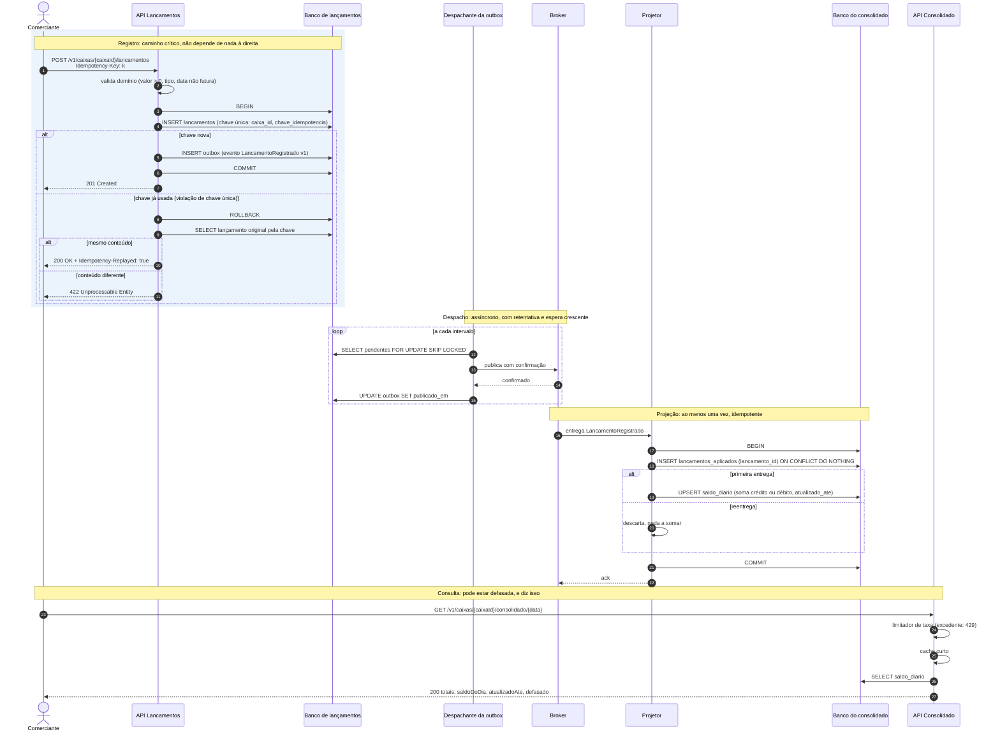

# Sequência: registro, despacho, projeção e consulta

Ordem das interações de um lançamento, do registro à consulta do saldo. Público: engenharia. Convenções em [README](README.md). Contrato do evento em [lancamento-registrado.v1.md](../contratos/lancamento-registrado.v1.md).

## Onde está cada garantia

| Passo | Garantia | Requisito |
|---|---|---|
| 4 a 6 | Lançamento e evento gravados juntos ou nenhum dos dois | RNF-04, RF-07 |
| 4, 8 a 11 | Reenvio detectado pela chave única no banco, não por consulta prévia | RNF-07, RF-04 |
| 12 a 15 | Despacho fora do caminho do registro; broker fora não afeta o `201` | RNF-01 |
| 16 a 22 | Evento repetido não soma duas vezes; `ack` só depois do `COMMIT` | RF-10, RNF-04 |
| 23 a 27 | Consulta protegida por limitador; atraso sinalizado por `atualizadoAte` e `defasado` | RNF-02, RNF-03, RNF-05 |

O papel da aplicação em Lancamentos não tem `UPDATE` nem `DELETE` na tabela `lancamentos` (RNF-06). O `UPDATE` do passo 15 atinge só a tabela `outbox`.

## Estado

Todos os passos: **especificado**, implementação no Bloco 4. A fonte do estado é o [ESTADO.md](../ESTADO.md).
